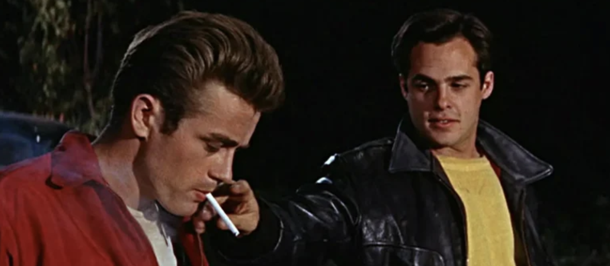

One might think that if a policy is unpopular, impactful, and raises our passions then we would express our disapproval in a mass movement.
History (and some amount of logic) suggests this is not really what happens.
The Trump administration did things continually that large majorities disapproved of but mass movements only occurred sporadically. We had to wait for large galvanizing events to coordinate opposition (like the killing of Alex Pretti).  It wasn't until our midterms that national opposition became apparent.

Why are we collectively so docile? There are "professional protesters" who can always be relied upon to express their views.
However, the majority of Americans (including me) cannot be held to that standard.
For us normies there is a cost to going to a protest.  This cost is primarily in time, but also money if you need to hire childcare or to take off work.

What might be counter-intuitive is that this cost seems small relative to the gains.  If I could end mass incarceration or corn subsidies for the cost of a few nights of babysitting, then I would do it in a heartbeat. However, this is not the decision that I am presented with as an individual citizen.  The decision is whether or not to go to a protest that may or may not work and my role is probably not decisive.

Going to a protest is only rational for an individual if the decision turns a failing protest into a successful one (if the protest is already successful you can free-ride). The protest is only successful if a lot of other normies go to it.  So the decision to go to a protest for a group of individuals feels like a prisoner's dilemma.

Strictly speaking this situation is not a prisoner's dilemma.  It's a combination of

1. The free-rider problem
2. Stag Hunt

I'll go through both these games briefly.  We will see how going to a protest in our current eco-system is not exactly rational, even if the protest yields great benefits to us all.  Then I'll provide a standard solution that changes the games so that going to such a protest is rational.

## Chicken and the free-rider problem
I don't want to say individuals do not matter, but a protest of one person really does not matter. MLK would not be MLK if he did not have a large group of activists alongside him. For a protest to be effective it needs to be large.  Perhaps 5% of the population.  There is no point in going to a protest that is too small (unless it's a trial-run to a larger one).
At the same time, we do not need 90% percent of the population to make a difference.  If the protest has 10% of the population, that is plenty large, and attending it will also not be rational.  So if you have other personal things pulling you, it's sensible to rely on others to shoulder the weight of going to protests.

This is an instance of the free-rider problem.
For clarity it's easier, and more fun, to consider the free-rider problem when there are only two people.  In this instance the free-rider problem is called "chicken".  This was a game played by idiot teenagers in the 1950s who would drive their cars towards a cliff.

The first car to swerve would be deemed the loser.  Translating to our case of protests, this means the people going to protests are "losers" in this game.  There are three outcomes:
 - both cars swerve (both idiots lose)
 - one car swerves (one idiot wins and the other loses)
 - neither swerve (both idiots die)

There are 2 pure Nash equilibria (just one car swerves).  When there are multiple Nash equilibria rationality is not a thing.  We have a coordination problem.
There is no purely rational action we can expect a player to take.

**Conclusion**: Even if the outcome of a massive protest benefits everybody, it is not rational for an individual to attend a protest.

## Stag Hunt
The other dynamic I see at protests is that for "normies" it is not unlike going to a party where you may or may not have any friends. I personally do not like to go to a party unless I know some of my friends will be there. Without coordinating, this puts me and my friends in a situation described by a game called "Stag Hunt".

In stag hunt we have two hunters in a forest of deer and squirrels.  The hunters can cooperate and get a deer together.  However, either of the hunters can "defect" and go after a squirrel by themself.  Again there are three outcomes:

 - both hunters cooperate and get a stag (big win for both)
 - both hunters defect and get squirrels (small win for both)
 - one hunter defects while the other intended to cooperate (the defector gets a small win, the other hunter gets nothing)

Again, there are two pure Nash equilibria.  Both hunters cooperate, and both hunters defect.  In any case, rational behavior is not enough to determine the outcome.

I won't belabor the point further, except to say that there are now two games that model going to protests, and both games suggest that going to a protest that benefits everybody is not exactly rational.
We can grumble about this.  However, I think there is a solution.

## How to make protests rational
Here is the dumbest solution.  It's called an [assurance contract](https://en.wikipedia.org/wiki/Assurance_contract) and it's really the standard solution. This would be roughly what the assurance contract looks like in our context

> I, Larry, will attend protest X on March 25th if there are at least 2000 other attendees and at least 3 people from the following list also attend: 
> - Alice
> - Bob
> - Carl
> - Danielle
> - Edwin
> 
> If these conditions are not met by March 24th at 10:00am PST, then this contract is void. Violation of the contract carries a fine of $1.00. My attendance at this protest will be kept confidential until March 25th and will only be known by the people on this contract who are also attending.

This contract addresses both stag-hunt and chicken because

1. There is no risk of going to a protest that is too small (it's hardcoded in the contract).  This bypasses the free-rider problem.
2. There is no risk of going to a protest without my friends.  This bypasses the stag-hunt game.

Lastly, there is no risk to signing the contract because if you sign the contract there are only two outcomes:

1. The contract is triggered, and Larry + his friends go to a protest that is large enough to be worth the time.
2.  The contract is not triggered, and Larry is no worse off than he was before.

My proposal is to set up a platform to broker these sorts of contracts.
The game theory in a world of assurance contracts is trivial. Each individual must decide to sign or not sign a contract. The Nash equilibrium is for everybody to sign an assurance contract because the contract has no downside risk relative to the status quo.

Going to protests is now rational.

... with some steps in the middle.
With a trustworthy assurance contract broker it is rational to sign assurance contracts for protests that we align with. Since people are signing assurance contracts left and right, many of these contracts will get triggered, meaning protests will be attended.
Effectively this means that in a world with an assurance contract broker, going to protests is rational.

This might seem like a very minor and wonky idea.  However, I think this has the potential to be sneakily big. Perhaps it's easier to show rather than tell.

## Simulations

Each citizen is a node in a social network.
As a simulation we could imagine a citizen feeling comfortable going to a protest if a majority of their friends also go (so we are looking at the stag-hunt game).  Even ignoring the free-rider aspects, the typical dynamic is to see lots of small protests that never cascade into a mass movement.

<video controls loop muted playsinline width="100%">
  <source src="{{ '/simulation/grid_protest_T5_p0.05_L100.mp4' | relative_url }}" type="video/mp4">
  Your browser does not support the video tag.
</video>

In essence, if one group is active one day and takes a break, they look around and see they have inactive neighbors and the little protests evaporate. We just get a hum of small short-lived protests.

In contrast, in a world with an assurance contract broker the long term dynamics are very different. Assurance contracts serve as a storage mechanism where citizens are in a stand-by mode, waiting for enough neighbors to join.  This allows a cascade of growth much like the physical process of crystallization.

<video controls loop muted playsinline width="100%">
  <source src="{{ '/simulation/grid_protest.mp4' | relative_url }}" type="video/mp4">
  Your browser does not support the video tag.
</video>

## Challenges

What I envision is basically a platform for setting up assurance contracts. On this platform there are two types of users:

 - Organizations
 - Citizens

Organizations can propose actions.  Citizens can draw up assurance contracts to join actions.  The assurance contracts have the form of the one given here (i.e. a list of "friends" that will be hashed, as well as an expiration date for the contract)

I've created a prototype for such a platform, which I call [true colors](https://true-colors.onrender.com/).  The idea being that we are allowing citizens to show their true colors, which are otherwise hidden by strategic thinking and doubt.

To a large extent, this turns a social problem (galvanizing support) into a series of engineering problems.  The challenges I've been having with setting this up are

1. **Cybersecurity**:  I want the assurance contracts to be secret, perhaps even from the organization that stores them.  This way if a government seizes the data the individuals who joined are safe.
2. **Communication**:  Once a contract is triggered, how do we communicate with individuals?  If we store their emails this sacrifices cybersecurity a bit.  There are solutions, but they are technical and I need more people to work with me on landing on a good one, or a good compromise.
3. **Features**: The sky is the limit on how many features one could add, but too many features makes a platform overwhelming and will drive away users.

I think the biggest non-technical concern I have is related to education.  Will people get it?  Messaging is hard.  The contracts are simple, but they are not that intuitive.  The assurance contracts explicitly state ways for people to **not** participate in a protest.  So it's sometimes surprising to people when I claim that this will lead to bigger and more sensible protests. I am confident this would be a game-changing idea if people understood it.  I have no idea how to get enough people to understand it.